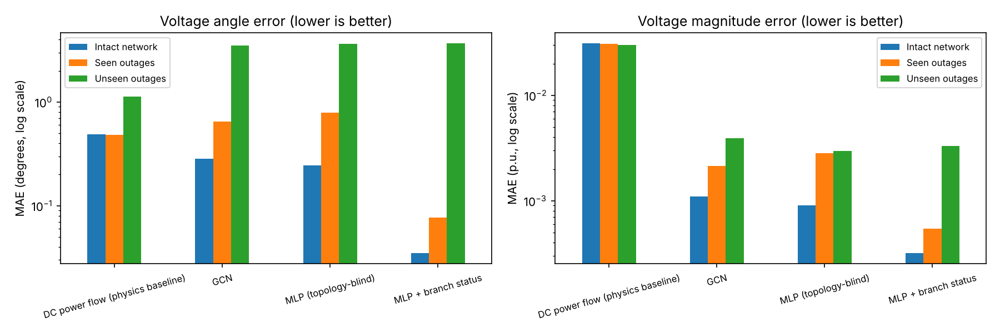

# Graph Neural Networks for Power-Flow Estimation: an honest benchmark

Can a **graph convolutional network (GCN)**, which "knows" the grid topology, estimate bus voltages better than ordinary neural networks, especially when a line trips and the topology changes? This repository tests that on the **IEEE 30-bus system**, using 6,000 AC power-flow solutions as ground truth and the classic **DC power-flow approximation** as a physics baseline.

**Short answer: no, not in this setup.** That negative result, and why it happens, is the main finding.

> **About this repository.** This is a 2026 reimplementation of a coursework project from my M.Tech at IIT Hyderabad (2023). All data is **synthetic**: it is generated by solving power flows on a public IEEE test network with [pandapower](https://www.pandapower.org/), so the code runs end-to-end without private data. The code was written with AI assistance; I have reviewed it and can explain every part of it.



## Results (1,726 test cases)

**Voltage angle, mean absolute error (degrees)**

| Model | Parameters | Intact network | Seen outages | **Unseen outages** |
|---|---:|---:|---:|---:|
| DC power flow (physics, no training) | – | 0.49 | 0.48 | **1.13** |
| MLP (topology-blind) | 135k | 0.25 | 0.79 | 3.65 |
| MLP + branch status | 146k | **0.035** | **0.077** | 3.68 |
| GCN | **30k** | 0.28 | 0.65 | 3.52 |

**Voltage magnitude, mean absolute error (p.u.)**

| Model | Intact | Seen outages | Unseen outages |
|---|---:|---:|---:|
| DC power flow (assumes 1.0 p.u.) | 0.031 | 0.031 | 0.030 |
| MLP (topology-blind) | 0.0009 | 0.0028 | **0.0030** |
| MLP + branch status | **0.0003** | **0.0005** | 0.0033 |
| GCN | 0.0011 | 0.0021 | 0.0039 |

"Unseen outages" are trips of 8 lines that were **never** out of service in the training data.

## What this shows

1. **The GCN did not beat a plain neural network.** On the intact network and on outages seen in training, a fully connected network that is simply *told* which branches are in service is about 8 times more accurate on angles than the GCN.
2. **No learned model generalises to unseen topologies.** When a line the models never saw tripped, every neural network's angle error rose to about 3.5°. The DC approximation, which uses the physics and needs no training, stayed at 1.1°. This is the most important result: an ML power-flow model trained on normal operation should not be trusted during unusual contingencies.
3. **The GCN is far more parameter-efficient** (30k vs 135k parameters) and is permutation-equivariant by design (checked in `tests/`). Graph structure is a sensible inductive bias, but on its own it isn't enough.
4. **Learned models are excellent at voltage magnitude**, which the DC approximation ignores entirely (it assumes 1.0 p.u.).

**Why the GCN struggles, and what to try next:**
- Plain GCN mixing treats every branch the same. In real power flow, how much one bus affects another depends on line **impedance**. Using admittance-weighted edges or edge features (for example a GNN with edge attributes, or a message-passing network) is the obvious next step.
- Voltage angles are a **global** quantity, measured relative to the slack bus. Six GCN layers only reach six hops, and repeated averaging smooths the signal ("over-smoothing").
- **Physics-informed** approaches, such as learning a correction to the DC solution or adding a power-balance loss, combine the robustness of point 2 with the accuracy of the neural networks.

## Method

**Data** (`src/gnnpf/data.py`). The IEEE 30-bus case from pandapower: 30 buses, 34 lines, 7 transformers. For each sample:
- every load is scaled by a system factor (0.7–1.3) times a local factor (0.85–1.15);
- the main generator's output is varied (±40%);
- in 50% of samples one line is taken out of service, using only outages that keep the grid connected;
- a full **AC power flow** is solved (the target) and a **DC power flow** for comparison.

Samples where the AC power flow did not converge are skipped (14 out of 6,014).

**Inputs per bus:** active and reactive load, generator setpoint, voltage setpoint, and the bus type (slack / PV / PQ). **Targets:** voltage magnitude and angle.

**Split:** 3,474 train / 800 validation / 1,726 test. A quarter of the outage-able lines are held out completely, giving the "unseen outages" test.

**Models** (`src/gnnpf/models.py`, PyTorch):
- **GCN:** input layer, then 6 graph-convolution layers with residual connections, then a per-bus output head. The adjacency matrix is rebuilt for every sample from the branches in service.
- **MLP:** flattens all bus features into one vector (2 hidden layers of 256 units).
- **MLP + branch status:** the same MLP, also given a 0/1 vector of branch states.

**Training:** Adam (learning rate 1e-3), mean squared error on standardised targets, up to 300 epochs, with early stopping on the validation set.

## Repository structure

```
├── src/gnnpf/
│   ├── data.py      # power-flow sample generation, adjacency matrices
│   ├── models.py    # GCN and MLP models
│   └── train.py     # training loop, early stopping, error metrics
├── scripts/run_experiment.py   # generates data (if missing), trains, evaluates, plots
├── results/figures/ and results/tables/
└── tests/test_gnnpf.py         # physics sanity checks, outage handling, GCN equivariance
```

## How to run

```bash
pip install -r requirements.txt
python scripts/run_experiment.py   # about 5 min to generate data + 10-15 min to train on a laptop CPU
pytest
```

## Limitations

- One small test network (30 buses). Results may differ on larger grids, where locality matters more and a fully connected network scales badly.
- Only single-line outages, and only one model configuration of each kind (no hyperparameter search).
- Loads are scaled around the base case. A real deployment would need realistic load and renewable time series.

## License

MIT
